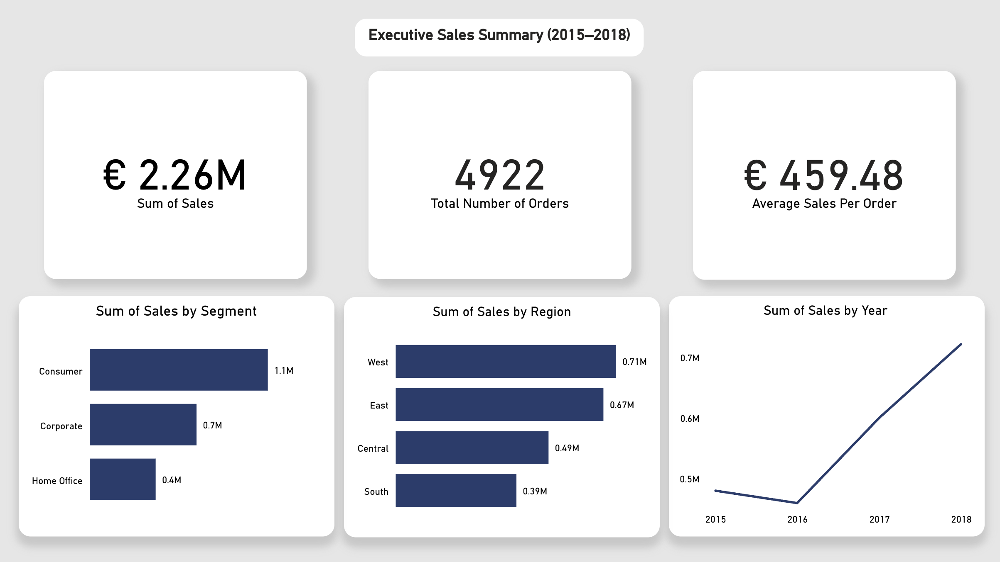
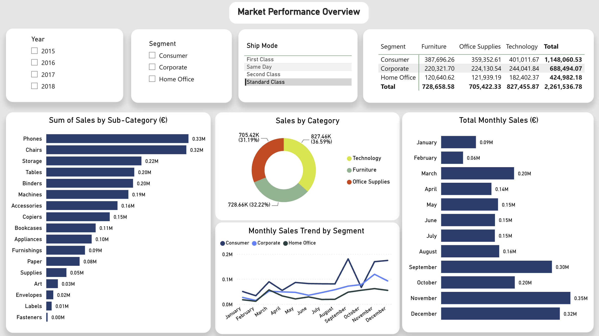
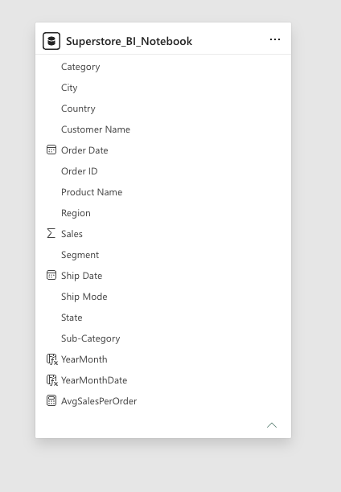

# Sales Data Analysis & Power BI Dashboard

A portfolio project demonstrating sales data preparation, exploratory analysis, business intelligence reporting and interactive dashboard development using Python, Pandas, Jupyter Notebook and Microsoft Power BI.

The repository contains two complementary but separate analyses:

- **Python Sales Data Analysis:** Data cleaning, aggregation and exploratory analysis of historical electronics sales records.
- **Power BI Sales Performance Dashboard:** A two-page interactive report analysing Superstore sales performance from 2015 to 2018.

**Note:** The Python notebook and Power BI dashboard use different datasets. Their results should not be combined or directly compared.

---

## 1. Power BI Sales Performance Dashboard

The Power BI report provides an executive-level view of sales performance and a detailed breakdown of customer segments, product categories, regions and monthly trends.

### Dashboard Preview





### Executive KPIs

| KPI | Result |
|---|---:|
| Total Sales | €2,261,536.78 |
| Total Orders | 4,922 |
| Average Sales per Order | €459.48 |
| Largest Customer Segment | Consumer |
| Largest Sales Region | West |
| Largest Product Category | Technology |

### Page 1: Executive Sales Summary

The executive page provides a high-level view of commercial performance through KPI cards, regional comparisons, customer segmentation and annual sales trends.

**Key findings**

- Consumer customers generated approximately €1.15 million in sales, the largest contribution among customer segments.
- The West region generated approximately €0.71 million, followed by the East at €0.67 million.
- Sales increased between 2016 and 2018, with 2018 recording the highest annual sales in the report.

### Page 2: Market Performance Overview

The market performance page enables more detailed exploration through year, segment and shipping-mode filters, category and subcategory comparisons, a sales matrix and monthly trend visualisations.

**Key findings**

- Technology generated €827,455.87, representing 36.59% of total sales.
- Furniture generated €728,658.58, representing 32.22%.
- Office Supplies generated €705,422.33, representing 31.19%.
- Phones and Chairs were the leading subcategories by sales.
- November recorded the highest aggregated month-of-year sales, followed by December and September.

### Business Questions

1. How did annual sales change between 2015 and 2018?
2. Which customer segments contributed the most sales?
3. Which geographical regions generated the highest sales?
4. Which product categories and subcategories were the strongest performers?
5. How did sales vary throughout the calendar year?
6. How did monthly trends differ across customer segments?

### Analytical Interpretation

The dashboard reveals differences in customer segment contributions, regional sales distribution and product category performance.

The findings support further investigation into geographical demand, product mix and seasonal sales patterns. However, the descriptive analysis does not establish why these differences occurred or demonstrate changes in profitability.

### Power BI Data Model



The Power BI model contains the `Superstore_BI_Notebook` table, including order information, sales values, product categories, customer segments, geographical attributes and shipping information.

The model also includes date-related calculated fields and an average-sales-per-order measure.

The dashboard was developed using Power BI Service, with interactive slicers, KPI cards, bar charts, a line chart, a doughnut chart and a matrix visual.

### Dashboard Demonstration

A recorded demonstration shows the dashboard's interactive filtering and navigation.

**Video:** [Interactive Power BI Sales Dashboard Demonstration](https://youtu.be/w2pjmoucwtY)

*This link points to the original demonstration and will be updated when the new recording is published.*

---

## 2. Python Sales Data Analysis

The original analysis was developed using Python and Jupyter Notebook to investigate historical electronics sales data.

### Data Preparation

The notebook demonstrates:

- Combining monthly CSV files into a consolidated dataset
- Removing missing values and repeated header rows
- Converting quantity and price columns to numeric types
- Converting order dates into datetime values
- Deriving month, weekday and city attributes
- Preparing sales values for aggregation and visualisation

### Exploratory Analysis

The notebook investigates several business questions:

1. Which months generated the highest and lowest sales?
2. How did sales vary across months?
3. Which cities recorded the most purchases?
4. Which products were purchased most frequently?
5. How did purchases vary by weekday?
6. Which products appeared together in customer orders?

### Tools and Methods

- Python
- Pandas
- Matplotlib
- Seaborn
- Jupyter Notebook
- Data cleaning and type conversion
- Grouping and aggregation
- Exploratory data visualisation

### Python Analysis Limitations

The notebook represents exploratory work rather than a production analytics pipeline. Its analysis should be interpreted within the context of the underlying dataset.

Potential extensions include automated data validation, additional product-level analysis and formal evaluation of forecasting or recommendation approaches.

---

## 3. Technologies and Skills

| Area | Technologies / Methods |
|---|---|
| Programming | Python |
| Data preparation | Pandas, CSV, Excel |
| Exploratory analysis | Jupyter Notebook, Matplotlib, Seaborn |
| Business intelligence | Microsoft Power BI Service |
| Data modelling | Power BI semantic model |
| Calculations | DAX measures and calculated fields |
| Reporting | KPI design, interactive filtering, trend analysis |
| Documentation | GitHub, Markdown |

## 4. Repository Structure

```text
sales_data_analysis/
├── Sales_Data/
├── screenshots/
│   ├── 01-executive-sales-summary.png
│   ├── 02-market-performance.png
│   └── 03-semantic-model.png
├── sales_data_analysis.ipynb
├── combined_sales_data.csv
├── cleaned_df.xlsx
├── README.md
└── LICENSE
```

## 5. Reproducing the Analysis

### Python Notebook

1. Download or clone the repository.
2. Install the required Python libraries: `pandas`, `matplotlib` and `seaborn`.
3. Open `sales_data_analysis.ipynb` in Jupyter Notebook.
4. Update any local file paths to match the downloaded repository.
5. Run the notebook cells in sequence.

### Power BI Report

The repository includes screenshots of the Power BI dashboard and semantic model.

The original editable Power BI report and full DAX definitions are not currently distributed in this repository. The screenshots and demonstration video provide evidence of the completed dashboard.

## 6. Overall Conclusion

The project demonstrates two approaches to sales analytics: Python-based exploratory analysis and Power BI-based interactive reporting.

The Python notebook provides evidence of data preparation, transformation and exploratory analysis, while the Power BI dashboard demonstrates KPI development, multidimensional sales comparisons and interactive business intelligence reporting.

Together, these projects demonstrate the ability to work with sales data, identify patterns and communicate findings through analytical visualisations.

---

**Project type:** Personal data analytics and business intelligence portfolio project.
